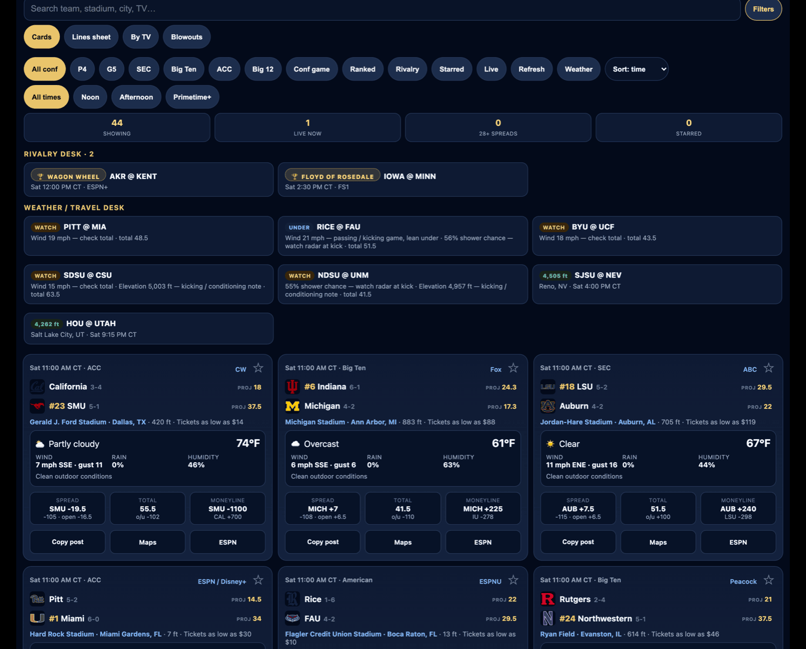
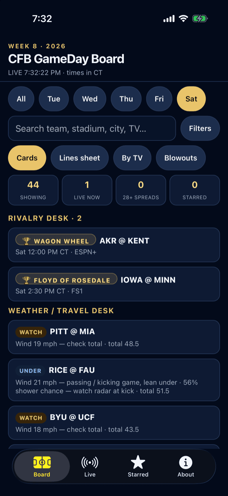
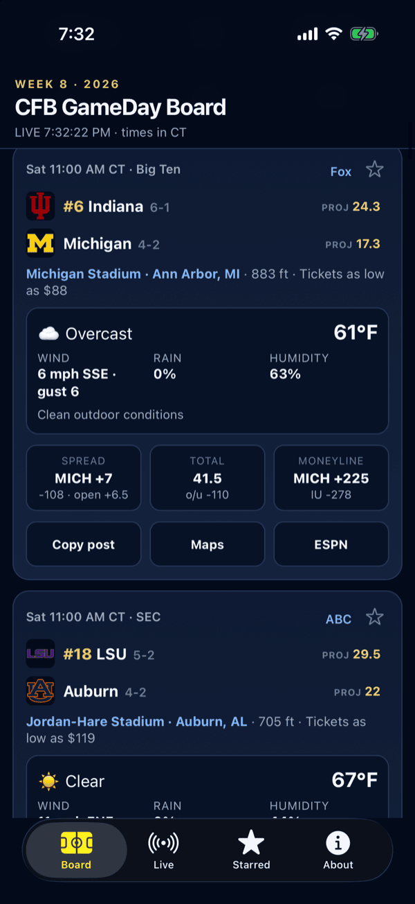
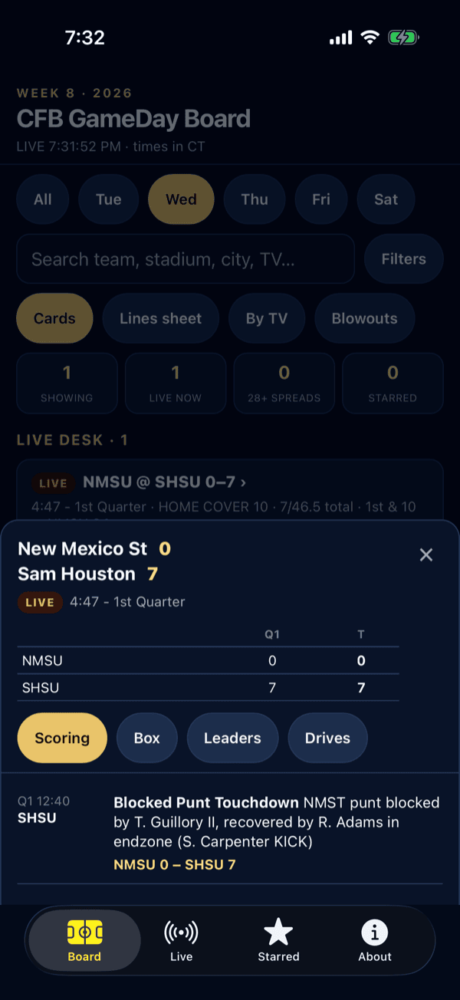
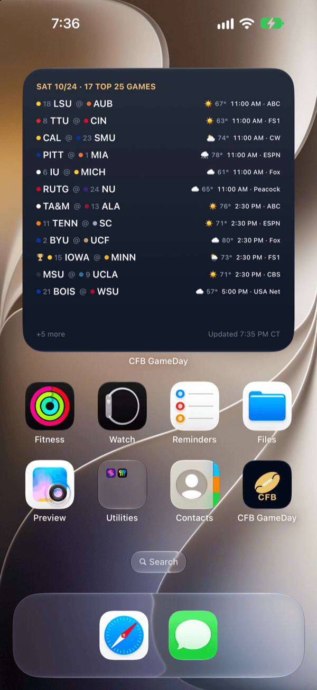

# CFB GameDay Board

College football slate board. Built for scanning a Saturday slate in one
place: venue, kickoff-hour weather, DraftKings lines (via ESPN), implied scores,
TV/streams, then live score / cover / total state once games start, and a game
sheet (scoring, box score, leaders, drives, ESPN win probability) for any game
that has kicked off.

Dark, mobile-first, ESPN-style cards. No build step, no framework, no accounts.

- **Web:** https://cfbgameday.app. Deploys from `main` on every push. The
  snapshot rebuilds itself seven times a week via GitHub Actions (two on Tuesday, Wed,
  Thu, Fri and two on Saturday), each well ahead of kickoff, and heals itself if a run
  drops kickoff forecasts.
- **iPhone, iPad and Mac:** SwiftUI shell around the same board, in `ios/`. On the App Store
  since 2026-09-10, currently 1.0.5 (Rivalry Games quick action and `cfbgameday://` links,
  since 2026-10-20), with 1.1 (Today's Games widget and universal links) in App Review
  since 2026-10-21; iPad and a resizable Mac window since 1.0.3 (2026-10-10):
  https://apps.apple.com/app/id6809035228

<p align="center"></p>
<p align="center">
  
  
  
  
</p>
<p align="center"><sub>Week 8, 2026, captured October 21: the Saturday slate on the web; in the iPhone app, the rivalry and weather desks, a game card, a live game sheet, and the Today's Games widget (1.1) on Top 25.</sub></p>

## What's on the board

- Every FBS game Tuesday through Monday, kickoff in Central time, filterable by
  day, window, conference, ranked, rivalry, weather, starred, or a search.
- Rivalry games: every named trophy game gets a banner on its card and a spot on
  the rivalry desk, and `#rivalry` links straight to the week's trophy games.
- Bowl season and the playoff use the same board, labelled by round.
- Four views: Cards, Lines sheet (with CSV download), By TV, and a Blowouts
  board for spreads of 28 or more.
- Kickoff-hour forecast per venue, with a weather score that only counts what
  suppresses scoring (wind, rain, cold). Heat is shown but never flagged UNDER.
- Implied team scores from the spread and total, shown only before kickoff.
- Live mode: score, clock, down and distance, last play, and whether each side
  is covering the posted spread and total, polled every 30 s. A Live desk groups
  the games in progress.
- Game sheet: tap Game on a live or final card for the scoring summary, team box,
  leaders, drives, and win probability. It never carries odds.

## In the app

- Native Board, Live, Starred and About tabs over the same board, pull to refresh,
  an offline screen with Retry, and outside links (maps, ESPN) open outside the app.
- Reloads by itself when you return to a slate that has gone stale.
- iPad: any orientation, two or three columns on a wide screen. Mac (Apple silicon): a resizable window.
- Board menu on iPad and Mac: Command-1 to 4 switch tabs, Command-F finds a game,
  Command-R reloads.
- Home Screen quick actions (from 1.0.4): long-press the icon for Live Games, Starred,
  By TV, or Rivalry Games (from 1.0.5).
- `cfbgameday://` links (from 1.0.5) open the app on a view: `rivalry`, `live`, `starred`,
  `tv`, `board`, or `game/<ESPN id>`. The App Store's in-app event cards use them.
- Today's Games widget (from 1.1): small, medium and large on the Home Screen, plus the
  Lock Screen. Live scores, kickoff times, TV and the kickoff forecast for the day's games;
  Edit Widget picks All games, Top 25 or Rivalry games, and a live or final game opens its
  game sheet. It reads `games.json` and `/api/live`, never odds or implied scores.
- Links to the board (from 1.1) open in the app when it is installed: `cfbgameday.app` and
  its `#rivalry`, `#live`, `#starred`, `#tv` and `#game/<ESPN id>` views. Other pages
  (`/privacy`, `/support`) stay in Safari.

## No keys, no accounts

- No API keys are required for a local run.
- ESPN's scoreboard feed and Open-Meteo are public and keyless.
- Live mode is a local proxy to ESPN on `127.0.0.1`, not a sportsbook
  connection. Nothing here logs into or scrapes DraftKings, FanDuel, or any
  book.
- Not betting advice.

## Run locally

```
python3 server.py
open http://127.0.0.1:8765/
```

`server.py` is a stdlib `ThreadingHTTPServer` bound to `127.0.0.1:8765`. It
serves the folder and exposes two ESPN proxies. `GET /api/live` returns
scores, clock, situation, and current odds for the slate's dates; the page polls
it every 30 s and merges the result onto the snapshot in `games.js`.
`GET /api/game?id=` returns one game's summary for the game sheet.

Opening `index.html` directly as a file works for the snapshot only. Live mode
needs the server because the browser cannot call ESPN directly.

## File map

| File | Role |
| --- | --- |
| `index.html` | UI shell and all CSS. The block between `<!-- games:start -->` and `<!-- games:end -->`, the week kicker, `<title>` and meta description are generated by `refresh_week.py` - edit the generator, not the block |
| `app.js` | All client logic: filters, views, live merge, cover/total math |
| `games.js` | Snapshot payload as `window.CFB_DATA = {...}` (loaded by the page) |
| `games.json` | Same payload as plain JSON |
| `server.py` | Static server + `/api/live` and `/api/game` ESPN proxies with per-date / per-game caches |
| `CONTEXT.md`, `AGENTS.md` | Operator notes: live state and the map of everything that runs unattended. Not needed to run the board |
| `scripts/refresh_week.py` | Rebuilds `games.json` / `games.js` for a new date range, plus the generated block in `index.html` and `sitemap.xml` |
| `docs/ARCHITECTURE.md` | Snapshot vs live, ESPN endpoints, Open-Meteo process, weekly rebuild |
| `docs/screenshots/` | The images in this README (live board and iOS simulator, Week 8 2026) |
| `docs/superpowers/` | Design specs and plans for larger features (e.g. the game sheet) |
| `scripts/check.py` | Offline smoke test: flag table, CT kickoff, cover/total math, snapshot shape, structured data |
| `scripts/run_summary.py` | Prints the build's counts and warnings as Markdown for the GitHub Actions step summary |
| `scripts/ci_heal.py` | Rebuilds once in CI when a run dropped kickoff forecasts (a forecast or venue-geocode failure), keeping the better result; `--verify` fails the job if still degraded |
| `scripts/promo_text.py` | Builds the week's App Store promotional text from `games.json`; `--apply` pushes it with `asc` |
| `manifest.webmanifest`, `sw.js`, `icons/` | PWA: install metadata, UI-shell service worker, home-screen icons |
| `api/live.py`, `vercel.json` | The same ESPN proxy as a Vercel function, CDN-cached 20 s; project config |
| `api/game.py` | Game sheet detail (scoring, box, leaders, drives, win probability) from ESPN's game summary |
| `.github/workflows/refresh.yml` | Scheduled snapshot rebuild that commits `games.json` / `games.js` |
| `privacy.html`, `support.html`, `site.css` | Public pages required for the App Store listing; shared stylesheet |
| `.well-known/apple-app-site-association` | Universal links: lets iOS open board links (`/` and `/index.html` only) in the app; served as JSON via `vercel.json` |
| `ios/` | SwiftUI iPhone and iPad app (also runs on Apple silicon Macs): `project.yml` (XcodeGen spec, versions, team), sources in `CFBGameDay/`, the Today's Games widget in `CFBGameDayWidget/`, unit tests and widget renders in `CFBGameDayTests/` (frozen Week 8 snapshot), `ExportOptions.plist`, listing copy in `APP_STORE.md`, App Review reply kit `APP_REVIEW_REPLY.md`, live listing metadata in `metadata/` (asc round-trip), review narration `narration.txt` + `narrate.mts` |
| `scripts/release_ios.sh` | One-command iOS release: archive, export, validate, upload, attach (and `--submit`) via the `asc` CLI, altool fallback; stops if the archive or IPA is missing, and `ASC_SIGNING_KEY_ID` signs the export with an API key when Xcode has no account |
| `scripts/ios_tab_check.sh` | Simulator smoke test: drives the tabs with AXe and fails on a blank revisit |
| `scripts/review_mux.py` | Lays the narration lines over a phone screen recording at cue times, outputs H.264 for App Review |
| `scripts/tunnel.sh` | Gameday Cloudflare quick tunnel for the local server (fallback only) |
| `CLAUDE.md` | Rules and conventions for working in this repo with an AI agent |
| `.vercelignore` | Keeps `ios/`, docs, scripts, and local state out of the Vercel upload |
| `docs/DEPLOY.md`, `deploy/` | Hosting: Vercel (live), tunnels, and self-host drafts |

## Install on iPhone (PWA)

The board is a Progressive Web App: a manifest, home-screen icons, and a
service worker that caches only the UI shell. Live scores are never cached.

1. Serve it somewhere Safari on the phone can reach. On the same Wi-Fi that is
   `http://<your-mac-ip>:8765/` only if you change the bind address in
   `server.py`; off-LAN needs a tunnel (Cloudflare Tunnel or Tailscale Serve).
   The default `127.0.0.1` bind is deliberate, see Limitations.
2. Open the URL in Safari (not Chrome; iOS only installs PWAs from Safari).
3. Tap Share, then **Add to Home Screen**, then Add.
4. Launch it from the icon. It opens full-screen with the dark status bar,
   remembers stars, and shows the last snapshot if the server is unreachable
   (the header says so instead of LIVE).

The page shows a one-time Add-to-Home-Screen hint in Safari on iOS; dismiss
with the ×. Ship a new shell by bumping `VERSION` in `sw.js`.

Fastest way to get the phone on it from anywhere, on gameday only:

```
brew install cloudflared
scripts/tunnel.sh        # starts server.py if needed, prints the https URL, Ctrl+C ends both
```

Stable hostnames, Tailscale, and an always-on box are in `docs/DEPLOY.md`.

### iPhone QA checklist

Test portrait on a 390 to 430 wide phone (iPhone 13 through 16 Pro Max).

- No horizontal page scroll. Chip rows scroll; the page must not.
- Dynamic Island / notch does not cover the week label or the LIVE timestamp.
- Tapping the search field does not zoom the page (input is 16px).
- Chips, star, Copy, Maps, ESPN all hit on the first tap (44pt targets).
- Live cover line wraps. Once a game starts the `proj` implied score is gone
  entirely, so nothing collides with the white score; the column stays aligned
  against pre-kick cards.
- Add to Home Screen opens standalone with no Safari chrome and a dark
  status bar.
- Airplane mode: the shell and last snapshot load, the header shows a live
  error, no fake scores.

## Weekly refresh

The GitHub Action does this on a schedule. To run it by hand:

```
python3 scripts/refresh_week.py
python3 scripts/promo_text.py --apply   # App Store promotional text for the week (needs asc)
```

With no arguments it targets Tuesday through Monday of the slate in progress
(a new slate starts on Tuesday, so midweek MAC and CUSA games are included). Pass `--start 20260911 --end
20260914` to pick dates. Rerun it on a game morning to refresh the forecast to
same-day accuracy, then restart `server.py`.

`--no-enrich` skips the per-game ESPN summary pass (~26s of the runtime) when
you just want a fast local rebuild. `--seo-only` rebuilds only the generated
block in `index.html` and the `sitemap.xml` lastmod from the committed
`games.json`, with no network calls at all. A normal run writes all four files,
so commit `games.json games.js index.html sitemap.xml` together.

The Action runs it seven times a week - Tue 4 AM with a Tue 10 AM backup, Wed 1 PM, Thu 7 AM,
Fri 7 AM, Sat 4 AM and a Sat 8 AM backup. Each is scheduled hours ahead of when it is actually needed because
GitHub creates scheduled runs late under load (measured 5h08m late once on this
repo) and can drop them entirely.

That pulls the ESPN scoreboard for each date, geocodes each venue city with
Open-Meteo, pulls the hourly forecast at the local kickoff hour (a failed lookup
gets one retry from a per-run budget, since it leaves the game with no forecast), computes the
derived fields (implied score, weather flags, impact notes, CT kickoff), and
writes both `games.json` and `games.js`. Details in `docs/ARCHITECTURE.md`.

## Cover / total math

Live cards use the posted home spread and the current margin:

```
margin   = home score - away score
coverBy  = margin + homeSpread      (> 0 means HOME is covering)
overNeed = total - (home + away)
```

The spread and total are the DraftKings numbers ESPN publishes in its
scoreboard feed, refreshed with each live poll. They are a snapshot of the
posted line, not a live steam feed.

## Limitations

- ESPN's scoreboard is an undocumented public feed. It 403s some hosts and
  changes without notice. `server.py` falls back across three ESPN hosts.
- Weather is the Open-Meteo forecast for the venue city at the kickoff hour,
  captured when the snapshot was built. It updates with each scheduled rebuild
  (the last one runs Saturday morning), not live.
- Geocoding is by city name, not stadium coordinates. Elevation comes from the
  geocoder, so it is the city's elevation, not the field's.
- Odds come only from what ESPN exposes (DraftKings). No sportsbook scraping.
- The per-game `enrich` block fills in over the season: playing surface and the
  ESPN projection are there from the start, but ATS records and attendance come
  back empty in the early weeks and stadium capacity is usually null.
- Times display in America/Chicago regardless of venue.
- The local server keeps closing lines in `lines.json`; the hosted site keeps
  them in the browser's local storage, so they are per device.
- Hosting details, tunnels, and self-host drafts are in `docs/DEPLOY.md`.

## Snapshot note

The committed `games.json` / `games.js` is whatever the refresh Action last
wrote; its `generated_at` and `week_label` say which slate. Lines and weather
are as of that moment, with the last posted line carried forward once ESPN
drops odds at kickoff.

## Secrets policy

There are none. The repo must never contain `.env` files, API keys, AWS
credentials, sportsbook cookies, or model-provider tokens. `.gitignore` blocks
the usual filenames; scan the tree before adding anything new.

## License

MIT. See `LICENSE`.
