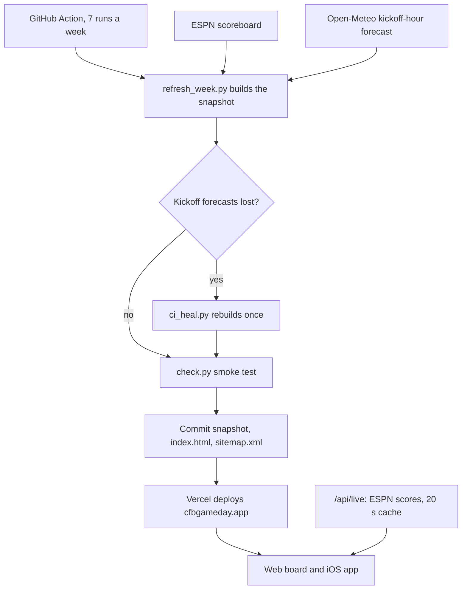

# CFB GameDay Board: case study

A five-minute read on what the board does, how it stays current, and why it is built this way. Every number
and date comes from this repo (`README.md`, `docs/ARCHITECTURE.md`, `docs/DEPLOY.md`, `ios/APP_STORE.md`,
`CONTEXT.md`). Dates are 2026 unless noted, and times are Central.

## The problem

On a college football Saturday, the facts a fan checks before kickoff live in different places: where each
game is played, the weather at kickoff, which channel has it, and the posted lines. CFB GameDay Board puts
every FBS game of the week on one page, then follows the scores live once games start.

It is for people who follow a whole slate rather than one team. It runs at https://cfbgameday.app and as an
App Store app for iPhone, iPad and Mac.

## How the weekly snapshot works

Venue, kickoff time, TV, the kickoff-hour forecast and the posted lines do not change during a game, so they
live in a weekly snapshot (`games.json` and `games.js`) built by `scripts/refresh_week.py` and committed to
git. The board renders from it even with no network.

**ESPN data.** The build reads ESPN's public scoreboard for each date from Tuesday through Monday, so midweek
MAC and CUSA games are included. The feed is undocumented, so the code falls back across three ESPN hosts.
ESPN stops publishing a game's posted line at kickoff, and the first automated run, on September 5, lost lines
for games in progress. The build now carries the previous line forward when ESPN has none.

**Kickoff-hour weather.** Open-Meteo geocodes each venue city, and the build keeps the forecast for the local
kickoff hour. Matches are filtered to the venue's state, or its country when it is overseas, after the Week 0
game in Dublin, Ireland got Dublin, Ohio's weather. Each game gets two weather scores. One counts all weather,
heat included. The other counts only wind, rain and cold, which tend to hold scoring down, so a calm, very hot
game is marked hot and nothing more.

**Week labels.** The label comes from each game's own season type and week number in ESPN's data. A dry run of
the 2025 postseason through the real build on October 20 found every postseason window labelled "Postseason ·
2025", Week 15 included, because the code read a league-level field. It now produces Rivalry Week,
Championship Week, Bowl season, each playoff round and the National Championship.

**The self-healing refresh.** A GitHub Action runs the build seven times a week: Tuesday at 4 AM and 10 AM,
Wednesday at 1 PM, Thursday and Friday at 7 AM, and Saturday at 4 AM and 8 AM. Runs are scheduled hours early
because GitHub starts scheduled runs late (5 hours 8 minutes once on this repo) and sometimes drops them.

The heal step exists because a lost forecast used to be invisible. A CI run on September 17 lost 8 of 75
forecasts to network timeouts, those games read "Clean outdoor conditions", and a 98°F game lost its heat
flag. Now each forecast and geocode gets one retry from a budget of 20 per run, failures are recorded in the
snapshot's `warnings` and `counts`, and `scripts/ci_heal.py` rebuilds once when forecasts are still missing,
keeps the better result, and fails the job if it is still degraded. Then `scripts/check.py` runs, the Action
commits, and Vercel deploys.

During games the page polls `/api/live` every 30 seconds. On Vercel that is a small Python function in front
of ESPN with a 20 second CDN cache, so one ESPN pull serves every viewer in that window.

## The iOS app: a thin native shell

The app is SwiftUI around the same board the website serves. Native Board, Live, Starred and About tabs drive
the page through URL fragments such as `#live`. The native layer adds pull to refresh, an offline screen with
Retry, a reload when you return to a stale slate, Home Screen quick actions, `cfbgameday://` deep links,
universal links, keyboard shortcuts on iPad and Mac, and the Today's Games widget. The widget is fully native.
It reads `games.json` and `/api/live` directly and shows no posted lines.

Because the board is the website, most changes need no app update. The game sheet reached the app on September
30 with no new build. The known risk is App Review guideline 4.2, minimum functionality, if a reviewer sees
only a web page. The native features above are the answer to that.

## Scripted App Store releases

`scripts/release_ios.sh --bump X.Y.Z` bumps the build number, archives, exports, validates, uploads, waits for
processing, creates the App Store version, applies its listing copy from `ios/metadata/` and attaches the
build, through the `asc` command-line client. First come `scripts/check.py`, the unit tests and
`scripts/ios_tab_check.sh`, which fails if a revisited tab renders blank (a real bug from September 7).
Afterwards, `asc review doctor` should report zero errors, warnings and blockers. Submitting is a separate
step, taken only on the owner's go. From 1.0.1 on, every version releases on approval. `scripts/promo_text.py`
writes the weekly promotional text from `games.json`, the one listing field Apple lets you change without
review.

## Release history, 1.0 to 1.1

From `ios/APP_STORE.md`.

| Version (build) | Submitted | Live | What it added |
| --- | --- | --- | --- |
| 1.0.0 (3) | Sep 5, resubmitted Sep 7 | Sep 10 | First release |
| 1.0.1 (4) | Sep 17 | Sep 18 | Reload when resumed on a stale slate, keyword cleanup |
| 1.0.2 (5) | Oct 7 | Oct 8 | Game sheet listing copy, ratings prompt, new screenshots, age rating fix |
| 1.0.3 (6) | Oct 9 | Oct 10 | iPad, resizable Mac window, Board menu, captioned screenshots, weather-led subtitle |
| 1.0.4 (7) | Oct 14 | Oct 15 | Home Screen quick actions |
| 1.0.5 (8) | Oct 20, with six in-app events | Oct 20 | Rivalry Games quick action, `cfbgameday://` deep links |
| 1.1.0 (9) | Oct 21 | Oct 22 | Today's Games widget, universal links, sixth screenshot |

Apple first rejected 1.0.0 citing guideline 2.1, Information Needed, because the developer account had no
review history. Six written answers and a recording from a physical iPhone got the same build approved. 1.0.5
exists because Apple requires in-app events to open inside the app, and its deep links are what the six events
open. After 1.0.0, every version cleared review in less than a day.

## Three decisions and their trade-offs

### No framework

The board is `index.html` (markup and all the CSS) and one `app.js`. There is no build step. The server, the
hosted live proxy and the snapshot builder use only the Python standard library, so nothing needs installing
beyond Python. The trade-off is that a framework's work is done and checked by hand. Every ESPN string must
pass through an `esc()` helper, and an automated review still found templates that had missed it (fixed
October 20). The web tests are one script, `scripts/check.py`, which pulls five functions out of `app.js` and
runs them in Node.

### No accounts or tracking

There is no sign-in, no analytics and no identifier. The App Store privacy label says no data is collected,
which holds because the only network calls go to `cfbgameday.app`. App Review needs no test account. The
costs: starred games and saved lines live in local storage and do not sync between devices, and with no web
analytics, how people use the site is unknown.

### A weekly snapshot instead of a live backend

There is no database and no always-on server, only a static snapshot in git and a stateless proxy for live
scores. The site is static files plus one function, and it still shows the last snapshot offline. The costs
are freshness and a dependence on GitHub's scheduler. Weather is as fresh as the last build, and the last
scheduled run is Saturday morning. The rule is no fake live weather, so nothing updates forecasts between
builds. Late or dropped cron runs are why there are seven runs a week, two of them backups.

## What comes next

### The playoff

The playoff runs on the same board, labelled by round: "CFP First Round", "CFP Quarterfinals", "CFP
Semifinals", "College Football Playoff", "Bowls & Playoff · 2026-27" for mixed windows, and "National
Championship · 2026-27". They replaced the broken labels the October 20 dry run found. On the calendar:

- November 24: check the Rivalry Week board. Its in-app event runs November 24 to 29.
- December 1 onward: postseason labels, starting with Championship Week. The first real bowl week is December
  15.
- In-app events: Bowl Season runs December 12 to January 11, Playoff Season December 18 to January 16, and
  National Championship January 18 to 26. Two featuring nominations went to Apple on October 21.

### The offseason

When the National Championship event ends on January 26, the season's events are done, and the weekly
promotional text goes back to the evergreen off-season line in the 1.0.0 listing metadata. The board keeps the
last snapshot, and its week label says which slate it is. The next dated item is April 2027, when Apple starts
requiring iPhone Duo screenshots for submissions, so the first release after that needs a new set.
